# 🍫 Ventas y rentabilidad de una cadena de tiendas de chocolate

**Proyecto final del programa Data & Analytics – ThePower Education**
Análisis exploratorio (EDA), análisis estadístico y dashboard de las ventas de noviembre y diciembre de 2023.

---

## 📖 1. Descripción del proyecto

Este proyecto analiza las ventas de una cadena de 100 tiendas de chocolate durante noviembre y diciembre de 2023. A partir de tres conjuntos de datos (ventas, tiendas y clientes) se realiza un proceso completo de análisis de datos: exploración, limpieza, integración, transformación, análisis descriptivo, análisis estadístico, visualización y construcción de un dashboard operativo.

La limpieza y el análisis se realizaron en **Python (Pandas)** con **Visual Studio Code**, y el dashboard se construyó en **Google Sheets**.

## 🎯 2. Objetivo y preguntas de análisis

**Pregunta principal**

> ¿Cómo evolucionaron las ventas y la rentabilidad de una cadena de tiendas de chocolate entre noviembre y diciembre de 2023, y qué características de las tiendas y de los clientes ayudan a explicar las diferencias observadas?

**Preguntas secundarias**

| Área | Pregunta |
|---|---|
| Evolución temporal | ¿Aumentaron las ventas en diciembre respecto a noviembre? |
| Rentabilidad | ¿El mes con mayores ingresos fue también el mes más rentable? |
| Tiendas | ¿Qué tiendas y qué tipos de establecimiento generaron más ingresos y beneficios? |
| Ubicación | ¿Existen diferencias de ventas entre países? |
| Clientes | ¿Qué características de los clientes están asociadas a un mayor gasto? |
| Descuentos | ¿Los pedidos con mayores descuentos presentan diferencias en ingresos y beneficio? |
| Productos | ¿Qué productos contribuyen más a los ingresos y cuáles al beneficio? |
| Estacionalidad | ¿Hay días de la semana o fechas concretas con más ventas? |
| Concentración | ¿Una pequeña parte de las tiendas o de los clientes concentra gran parte de los ingresos? |

## 🗃️ 3. Fuentes de datos

Los datos proceden del conjunto [Chocolate Sales Dataset 2023-2024](https://www.kaggle.com/datasets/ssssws/chocolate-sales-dataset-2023-2024) de Kaggle. Se utilizaron tres tablas, que se encuentran sin modificar en la carpeta `data/raw/`:

| Archivo | Contenido | Filas | Columnas | Clave de unión |
|---|---|---|---|---|
| `sales_nov-dec_2023.csv` | Transacciones de venta de noviembre y diciembre de 2023 | 83.129 | 11 | — |
| `stores.csv` | Características de cada tienda (nombre, ciudad, país y tipo) | 100 | 5 | `store_id` |
| `customers.csv` | Características de los clientes (edad, género, fidelización y fecha de alta) | 50.000 | 5 | `customer_id` |

Se utilizaron tres tablas porque permiten cumplir los requisitos de tamaño del proyecto (más de 50.000 filas y 20 columnas tras la unión) con una temática sencilla de interpretar.

## 🗂 4. Estructura del proyecto

```
Proyecto_Final_Data_and_Analytics/
├── data/
│   ├── raw/                          # Datos originales sin modificar
│   │   ├── sales_nov-dec_2023.csv
│   │   ├── stores.csv
│   │   └── customers.csv
│   └── limpio/
│       └── eda_final.csv             # Dataset final limpio e integrado
├── notebooks/
│   └── proyecto_final_EDA_python.ipynb   # Limpieza, EDA y análisis estadístico
├── images/                           # Gráficos generados en el notebook
├── dashboard/
│   ├── Dashboard_ventas_chocolate.xlsx   # Dashboard exportado desde Google Sheets
│   └── captura_dashboard.png             # Captura del dashboard
├── Proyecto Final - Data and Analytics.pdf   # Enunciado y planificación del proyecto
├── requirements.txt                  # Librerías necesarias para ejecutar el notebook
└── README.md                         # Descripción del proyecto e informe
```

## 🛠 5. Herramientas, instalación y requisitos

| Etapa | Herramientas |
|---|---|
| Limpieza, EDA y estadística | Python 3, Pandas, NumPy, Matplotlib, Seaborn, SciPy |
| Entorno de trabajo | Visual Studio Code (Jupyter Notebook) |
| Dashboard | Google Sheets |
| Control de versiones | Git y GitHub |

**Cómo ejecutar el proyecto**

1. Clonar el repositorio:
   ```bash
   git clone https://github.com/SofiaConsoli/Proyecto_Final_Data_and_Analytics.git
   ```
2. Crear y activar un entorno virtual (recomendado):
   ```bash
   python -m venv venv
   venv\Scripts\activate        # Windows
   source venv/bin/activate     # macOS / Linux
   ```
3. Instalar las librerías necesarias:
   ```bash
   pip install -r requirements.txt
   ```
4. Abrir `notebooks/proyecto_final_EDA_python.ipynb` en Visual Studio Code y ejecutar todas las celdas en orden. El notebook lee los datos de `data/raw/`, genera el dataset final en `data/limpio/` y guarda los gráficos en `images/`.

---

## 🔍 6. Exploración inicial

Se analizaron las dimensiones, los tipos de datos, los valores nulos y los duplicados de las tres tablas mediante `shape`, `info()`, `describe()`, `isnull()` y `duplicated()`.

**Principales hallazgos**

- **Valores nulos:** `sales` tenía 13 nulos en `store_id` y 52 en `unit_price`; `stores` tenía 5 nulos en `store_name`; `customers` no tenía nulos.
- **Duplicados:** no se encontraron filas duplicadas en ninguna tabla, y `order_id` es único, por lo que cada fila corresponde a un pedido de un único producto.
- **Formatos:** las fechas estaban almacenadas como texto, y las de diciembre tenían el mes escrito en español (por ejemplo, `2023-dic-31`).
- **Consistencia geográfica:** las ciudades de `stores` no se correspondían con sus países (por ejemplo, tiendas en «New York» con país «Canada»).
- **Coherencia de los importes:** se verificó que `revenue = unit_price × quantity × (1 − discount)` y que `profit = revenue − cost`, con diferencias máximas de 0,005 y 0,01 atribuibles al redondeo.
- **Rangos:** cantidad entre 1 y 5 unidades, precio unitario entre 3 y 15, descuento entre 0 % y 20 % y edades entre 18 y 70 años. `loyalty_member` usa los valores 1 y 0, y se conservó esa codificación.

## 🧹 7. Limpieza

Todas las modificaciones se realizaron sobre copias de los datos, conservando intactos los originales.

| Problema | Decisión | Motivo |
|---|---|---|
| Fechas de diciembre con el mes en texto («dic») | Se sustituyó «dic» por «12» y se convirtió `order_date` a fecha | Permitir el análisis temporal |
| `join_date` como texto | Conversión a fecha | Formato adecuado |
| 52 nulos en `unit_price` | Imputación con `revenue / quantity` | Todos tenían descuento 0 y cantidad válida, por lo que el precio podía recuperarse sin perder filas |
| 13 nulos en `store_id` | Eliminación de las filas | No se pueden asignar a una tienda y suponen solo el 0,016 % del total |
| 5 nulos en `store_name` | Reconstrucción con el patrón «Chocolate Store» + número de `store_id` | El patrón es constante en el resto de tiendas |
| Ciudades que no coinciden con su país | Reasignación de la ciudad según el país mediante un diccionario | Se asumió que el país es el dato correcto |

Tras la limpieza, la tabla de ventas pasa de 83.129 a **83.116 registros** y no quedan valores nulos.

## 🔗 8. Integración de datasets

Antes de unir las tablas se comprobó que `store_id` y `customer_id` no tenían duplicados en las tablas de referencia, ya que un identificador duplicado multiplicaría las filas durante la unión.

Se utilizó un **left join** con la tabla de ventas como principal (`how="left"`, `validate="many_to_one"`), porque las transacciones son la unidad de análisis del proyecto. El resultado conserva las 83.116 ventas, con 19 columnas y sin valores nulos, lo que confirma que todas las ventas tienen tienda y cliente asociados.

**Validación posterior a la unión:** el 45,39 % de las ventas figura con una fecha de alta del cliente (`join_date`) posterior a la compra, y el rango de altas (marzo de 2021 a marzo de 2026) excede el periodo analizado. Al no ser un dato fiable, `join_date` se conservó en el dataset pero **no se utilizó en el análisis**.

## 🧩 9. Transformación y dataset final

Se crearon seis variables derivadas para facilitar el análisis:

| Variable | Descripción |
|---|---|
| `month` | Mes de la venta, para comparar noviembre y diciembre |
| `day_of_week` | Día de la semana, para estudiar patrones semanales |
| `is_weekend` | Indicador de fin de semana (verdadero o falso) |
| `profit_margin_pct` | Margen de beneficio: `profit / revenue × 100` |
| `has_discount` | «Con descuento» o «Sin descuento» (se conserva también `discount` con su valor original) |
| `age_group` | Grupos de edad sin solapamientos: 18-29, 30-50 y más de 50 |

**Dataset final:** `data/limpio/eda_final.csv`, con **83.116 filas y 25 columnas**, sin valores nulos ni duplicados. Cumple los requisitos del proyecto (mínimo 50.000 filas y 20 columnas).

---

## 📊 10. Análisis descriptivo

### 10.1. Indicadores generales

| Indicador | Valor |
|---|---|
| Ingresos totales | 2.119.579,33 |
| Beneficio total | 847.970,32 |
| Unidades vendidas | 249.295 |
| Pedidos | 83.116 |
| Ticket medio | 25,50 |
| Margen de beneficio global | 40,01 % |

Como cada registro corresponde a un pedido con un único producto, el número de registros coincide con el de pedidos y el ticket medio equivale al ingreso medio por registro.

### 10.2. Evolución mensual

Como noviembre tiene 30 días y diciembre 31, además de los totales se calcularon los valores medios por día.

| Indicador | Noviembre | Diciembre | Variación |
|---|---|---|---|
| Ingresos totales | 1.039.203,48 | 1.080.375,85 | +3,96 % |
| Beneficio total | 415.974,33 | 431.995,99 | +3,85 % |
| Unidades vendidas | 122.417 | 126.878 | +3,64 % |
| Número de pedidos | 40.860 | 42.256 | +3,42 % |
| Ticket medio | 25,43 | 25,57 | +0,53 % |
| Margen de beneficio | 40,03 % | 39,99 % | −0,04 p. p. |
| Días con ventas | 30 | 31 | +3,33 % |
| Ingreso medio diario | 34.640,12 | 34.850,83 | +0,61 % |
| Pedidos medios diarios | 1.362,0 | 1.363,1 | +0,08 % |

En valores totales, diciembre supera a noviembre en todos los indicadores de actividad, pero ese aumento coincide con el 3,33 % más de días. Al comparar los valores medios por día, el ingreso diario solo aumenta un 0,61 % y los pedidos diarios un 0,08 %: **la mayor parte del crecimiento se explica por tener un día más**. El margen se mantiene prácticamente igual, por lo que diciembre tuvo más beneficio total pero no fue más rentable en términos porcentuales.

### 10.3. Ventas según el día de la semana

Entre el 1 de noviembre y el 31 de diciembre hay 8 lunes, 8 martes y 9 de cada uno de los demás días, por lo que se calculó el ingreso medio por día.

| Día | Nº de días | Ingresos totales | Ingreso medio por día | Pedidos medios por día | Ticket medio | Margen |
|---|---|---|---|---|---|---|
| Lunes | 8 | 276.443,37 | 34.555,42 | 1.350,88 | 25,58 | 40,02 % |
| Martes | 8 | 279.866,23 | 34.983,28 | 1.381,00 | 25,33 | 40,07 % |
| Miércoles | 9 | 315.741,65 | 35.082,41 | 1.365,56 | 25,69 | 39,96 % |
| Jueves | 9 | 314.855,33 | 34.983,93 | 1.376,44 | 25,42 | 39,99 % |
| Viernes | 9 | 309.118,53 | 34.346,50 | 1.340,56 | 25,62 | 40,00 % |
| Sábado | 9 | 306.852,70 | 34.094,74 | 1.354,33 | 25,17 | 39,98 % |
| Domingo | 9 | 316.701,52 | 35.189,06 | 1.369,89 | 25,69 | 40,04 % |

Lunes y martes registran los menores ingresos totales, pero porque aparecen un día menos. Al normalizar, el ingreso medio diario solo varía entre 34.095 (sábado) y 35.189 (domingo), un 3,2 %. **No se aprecia un patrón semanal marcado.**

### 10.4. Ventas por tipo de establecimiento y país

Como cada categoría tiene un número distinto de tiendas, se calculó el **ingreso por tienda**.

| Tipo de establecimiento | Nº de tiendas | Ingresos totales | Ingreso por tienda | Ticket medio | Margen |
|---|---|---|---|---|---|
| Airport | 30 | 637.761,30 | 21.258,71 | 25,47 | 40,05 % |
| Mall | 26 | 548.450,79 | 21.094,26 | 25,47 | 39,95 % |
| Online | 25 | 529.490,84 | 21.179,63 | 25,50 | 40,06 % |
| Retail | 19 | 403.876,40 | 21.256,65 | 25,61 | 39,95 % |

| País | Nº de tiendas | Ingresos totales | Ingreso por tienda | Ticket medio | Margen |
|---|---|---|---|---|---|
| Canadá | 20 | 421.475,99 | 21.073,80 | 25,29 | 40,08 % |
| Reino Unido | 19 | 404.653,32 | 21.297,54 | 25,58 | 39,98 % |
| Estados Unidos | 17 | 360.505,23 | 21.206,19 | 25,74 | 40,01 % |
| Francia | 17 | 355.136,66 | 20.890,39 | 25,34 | 40,03 % |
| Australia | 15 | 319.531,81 | 21.302,12 | 25,55 | 39,94 % |
| Alemania | 12 | 258.276,32 | 21.523,03 | 25,56 | 39,97 % |

Airport y Canadá lideran en ingresos totales porque tienen más tiendas. **Por tienda, los resultados son prácticamente iguales** (diferencias del 0,8 % entre tipos y del 3,0 % entre países).

A nivel individual, el ingreso medio por tienda es de 21.196. La mejor tienda (S066, 23.000,99) supera en un 8,5 % a la media y la peor (S053, 18.643,90) queda un 12,0 % por debajo. Las 10 mejores tiendas están muy próximas entre sí (entre 22.242 y 23.001) y suman el 10,7 % de los ingresos, casi lo mismo que su peso como tiendas.

**Ranking de tiendas con su país y tipo de establecimiento**

| Puesto | Tienda | País | Tipo de establecimiento | Ingresos | Pedidos |
|---|---|---|---|---|---|
| 1 | S066 | Estados Unidos | Online | 23.000,99 | 858 |
| 2 | S044 | Reino Unido | Aeropuerto | 22.907,89 | 868 |
| 3 | S033 | Australia | Tienda física | 22.851,54 | 869 |
| 4 | S091 | Reino Unido | Online | 22.835,09 | 906 |
| 5 | S062 | Canadá | Aeropuerto | 22.741,01 | 897 |
| 6 | S074 | Estados Unidos | Online | 22.727,82 | 858 |
| 7 | S032 | Reino Unido | Centro comercial | 22.582,73 | 860 |
| 8 | S042 | Estados Unidos | Online | 22.476,32 | 865 |
| 9 | S004 | Reino Unido | Aeropuerto | 22.273,09 | 837 |
| 10 | S027 | Alemania | Aeropuerto | 22.242,18 | 879 |
| … | | | | | |
| 96 | S054 | Canadá | Online | 19.894,67 | 809 |
| 97 | S069 | Francia | Tienda física | 19.888,94 | 787 |
| 98 | S024 | Francia | Online | 19.849,09 | 811 |
| 99 | S077 | Reino Unido | Aeropuerto | 19.772,18 | 777 |
| 100 | S053 | Estados Unidos | Tienda física | 18.643,90 | 751 |

Las mejores tiendas no se concentran en un país ni en un tipo de establecimiento: en el top 10 hay 4 tiendas de Reino Unido, 3 de Estados Unidos y una de Australia, Canadá y Alemania; por tipo, 4 Online, 4 Aeropuerto, 1 Tienda física y 1 Centro comercial. Además, Reino Unido y Estados Unidos tienen tiendas tanto entre las mejores como entre las peores.

**Regularidad de las tiendas de cada país**

| País | Tiendas | Ingreso medio por tienda | Mínimo | Máximo | Diferencia máx. − mín. | Mejor puesto | Peor puesto |
|---|---|---|---|---|---|---|---|
| Alemania | 12 | 21.523,03 | 20.569,68 | 22.242,18 | 1.672,50 | 10 | 78 |
| Australia | 15 | 21.302,12 | 19.942,76 | 22.851,54 | 2.908,78 | 3 | 94 |
| Reino Unido | 19 | 21.297,54 | 19.772,18 | 22.907,89 | 3.135,71 | 2 | 99 |
| Estados Unidos | 17 | 21.206,19 | 18.643,90 | 23.000,99 | 4.357,09 | 1 | 100 |
| Canadá | 20 | 21.073,80 | 19.894,67 | 22.741,01 | 2.846,34 | 5 | 96 |
| Francia | 17 | 20.890,39 | 19.849,09 | 21.975,77 | 2.126,68 | 14 | 98 |

Canadá es el país con más ingresos totales, pero por tienda es de los últimos. Alemania, con solo 12 tiendas, tiene el mayor ingreso medio por tienda y las tiendas más regulares: la menor diferencia entre su mejor y su peor tienda y ninguna tienda en los últimos 20 puestos. Estados Unidos, en cambio, tiene a la vez la mejor y la peor tienda de la cadena. Sin embargo, las diferencias de ingreso por tienda entre países no son estadísticamente significativas (ver apartado 11.3), por lo que la regularidad de Alemania es una línea a estudiar con más datos y no una recomendación.

### 10.5. Ventas según las características de los clientes

| Segmento | Grupo | Pedidos | % de pedidos | Ticket medio | Margen |
|---|---|---|---|---|---|
| Género | Mujer | 41.264 | 49,6 % | 25,52 | 40,05 % |
| Género | Hombre | 41.852 | 50,4 % | 25,49 | 39,96 % |
| Fidelización | No miembro | 41.414 | 49,8 % | 25,66 | 40,02 % |
| Fidelización | Miembro | 41.702 | 50,2 % | 25,34 | 39,99 % |
| Edad | 18-29 | 18.862 | 22,7 % | 25,50 | 40,00 % |
| Edad | 30-50 | 32.976 | 39,7 % | 25,51 | 40,00 % |
| Edad | Más de 50 | 31.278 | 37,6 % | 25,50 | 40,02 % |

El ticket medio y el margen son prácticamente iguales en todos los segmentos. Los miembros del programa de fidelización gastan un 1,2 % menos por pedido.

**Programa de fidelización: comportamiento por cliente**

Para valorar el programa no basta con el ticket medio: también hay que ver si los miembros compran más a menudo. Por eso se comparó el comportamiento de todos los clientes de la base (50.000), incluidos los que no compraron en el periodo.

| Indicador | No miembros | Miembros |
|---|---|---|
| Clientes | 24.896 | 25.104 |
| % de clientes que compró en el periodo | 81,3 % | 80,9 % |
| Pedidos por cliente | 1,66 | 1,66 |
| Ingreso por cliente | 42,69 | 42,10 |
| Beneficio por cliente | 17,08 | 16,84 |
| Ticket medio | 25,66 | 25,34 |
| % de pedidos con descuento | 36,8 % | 37,7 % |

Los miembros compran igual que los no miembros: la misma proporción de clientes compra, con el mismo número de pedidos y un ingreso y un beneficio por cliente prácticamente iguales (diferencias no significativas, ver apartado 11.3). Tampoco reciben claramente más descuentos. Los miembros aportan el 49,9 % de los ingresos simplemente porque son el 50,2 % de los clientes. **Con estos datos no se observa un efecto del programa sobre las compras, ni positivo ni negativo.** Las diferencias en los totales por edad se deben al tamaño de cada grupo, que coincide con la proporción de edades que abarca cada rango. **Ninguna característica de los clientes se asocia a un mayor gasto por pedido.**

### 10.6. Descuentos

| Descuento | Pedidos | % de pedidos | Ingresos totales | Ticket medio | Margen | Unidades por pedido |
|---|---|---|---|---|---|---|
| Sin descuento | 52.162 | 62,8 % | 1.406.690,81 | 26,97 | 40,04 % | 3,00 |
| 10 % | 10.283 | 12,4 % | 252.054,63 | 24,51 | 40,00 % | 3,01 |
| 15 % | 10.313 | 12,4 % | 237.600,31 | 23,04 | 39,92 % | 3,01 |
| 20 % | 10.358 | 12,5 % | 223.233,58 | 21,55 | 39,92 % | 2,99 |

El ticket medio baja en proporción al descuento aplicado (−9,1 %, −14,6 % y −20,1 %), mientras que las unidades por pedido (en torno a 3) y el margen (en torno al 40 %) no cambian. **Los descuentos no se asocian a compras de mayor cantidad.**

### 10.7. Productos

El catálogo tiene 202 productos. Los 10 productos con más ingresos y los 10 con más beneficio coinciden en 9 casos, encabezados por P0150 y P0010. Los 10 mejores concentran solo el 5,6 % de los ingresos y del beneficio, por lo que **ningún producto domina las ventas**.

### 10.8. Concentración de los ingresos

| Grupo | Total analizado | El 10 % superior aporta | El 20 % superior aporta |
|---|---|---|---|
| Tiendas | 100 | 10,7 % | 21,1 % |
| Clientes con compras | 40.561 | 25,0 % | 42,3 % |
| Referencia: reparto proporcional | — | 10,0 % | 20,0 % |

Entre las tiendas el reparto es casi proporcional. Entre los clientes hay una concentración moderada, explicada por el distinto número de compras de cada uno, pero lejos de un patrón 80/20.

---

## 📐 11. Análisis estadístico

### 11.1. Forma y dispersión de las variables

| Variable | Media | Mediana | Mínimo | Máximo | Desv. típica | Asimetría | Coef. de variación |
|---|---|---|---|---|---|---|---|
| Ingresos por pedido | 25,50 | 21,95 | 2,40 | 75,00 | 16,33 | 0,82 | 64,05 % |
| Beneficio por pedido | 10,20 | 8,62 | 0,73 | 37,17 | 6,76 | 0,95 | 66,26 % |
| Margen por pedido | 40,01 % | 40,01 % | 29,93 % | 50,08 % | 5,76 | −0,01 | 14,39 % |
| Cantidad | 3,00 | 3,00 | 1 | 5 | 1,41 | 0,00 | 47,13 % |
| Precio unitario | 9,01 | 9,03 | 3,00 | 15,00 | 3,45 | 0,00 | 38,30 % |
| Edad | 44,01 | 44,00 | 18 | 70 | 15,33 | 0,00 | 34,83 % |

Los ingresos y el beneficio por pedido son asimétricos a la derecha: predominan los pedidos pequeños y unos pocos pedidos grandes elevan la media, por lo que la mediana describe mejor el pedido típico. El precio, la cantidad, la edad y el margen siguen distribuciones prácticamente uniformes.

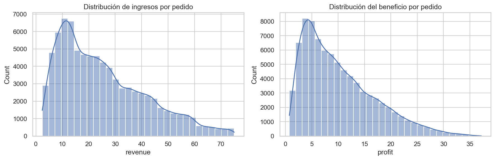

### 11.2. Valores atípicos

Se aplicó el criterio del rango intercuartílico (IQR).

| Variable | Límite superior | Valores atípicos | % sobre el total |
|---|---|---|---|
| Ingresos por pedido | 71,50 | 608 | 0,73 % |
| Beneficio por pedido | 28,29 | 1.252 | 1,51 % |
| Margen por pedido | 59,88 % | 0 | 0,00 % |

Los valores atípicos son pedidos de 5 unidades con precio alto, es decir, pedidos válidos y no errores, por lo que **se conservaron**.

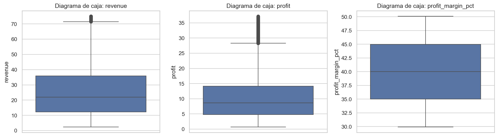

### 11.3. Contrastes de comparación de medias

El análisis descriptivo mostró diferencias muy pequeñas entre grupos. Para comprobar si son reales o se deben a la variación normal de los datos, se aplicaron contrastes estadísticos:

- **Test t de Welch** para comparar dos grupos, porque no exige que tengan la misma variabilidad.
- **ANOVA de un factor** para comparar dos o más grupos en una sola prueba.
- **Correlación de Spearman** entre el descuento y el margen, adecuada para variables con pocos valores ordenados.
- **Chi-cuadrado** para la relación entre el programa de fidelización y los descuentos.

Se consideró significativa una diferencia con p-valor inferior a 0,05. Como una muestra de más de 83.000 pedidos permite detectar diferencias mínimas, también se valoró si el tamaño de cada diferencia es relevante para el negocio.

| Contraste | Grupos comparados | p-valor | Resultado |
|---|---|---|---|
| Ingreso diario | Diciembre / Noviembre | 0,3683 | Sin diferencia significativa |
| Importe por pedido | Diciembre / Noviembre | 0,2366 | Sin diferencia significativa |
| Ingreso diario | Fin de semana / Entre semana | 0,6186 | Sin diferencia significativa |
| Importe por pedido | Género | 0,7814 | Sin diferencia significativa |
| Importe por pedido | Programa de fidelización | 0,0050 | Diferencia significativa |
| Importe por pedido | Grupo de edad | 0,9948 | Sin diferencia significativa |
| Importe por pedido | Tipo de establecimiento | 0,8297 | Sin diferencia significativa |
| Importe por pedido | País | 0,1735 | Sin diferencia significativa |
| Margen | Tipo de establecimiento | 0,4817 | Sin diferencia significativa |
| Margen | País | 0,2846 | Sin diferencia significativa |
| Margen | Nivel de descuento | 0,0616 | Sin diferencia significativa |
| Importe por pedido | Nivel de descuento | < 0,0001 | Diferencia significativa |
| Pedidos con descuento | Programa de fidelización (chi-cuadrado) | 0,0083 | Diferencia significativa |
| Ingreso por tienda | País | 0,3765 | Sin diferencia significativa |
| Ingreso por tienda | Tipo de establecimiento | 0,8756 | Sin diferencia significativa |
| Pedidos por cliente | Programa de fidelización | 0,8405 | Sin diferencia significativa |
| Ingreso por cliente | Programa de fidelización | 0,0915 | Sin diferencia significativa |

De los 17 contrastes, solo 3 resultan significativos. La bajada del importe por pedido con el descuento es esperable, porque el descuento reduce el precio pagado. Las otras dos diferencias (los miembros gastan un 1,2 % menos y reciben descuento en un 0,88 p. p. más de pedidos) son significativas por el gran tamaño de la muestra, pero **demasiado pequeñas para tener relevancia práctica**. La correlación de Spearman entre descuento y margen es prácticamente nula (−0,009).

### 11.4. Correlaciones

| Relación | Correlación | Lectura |
|---|---|---|
| Ingresos – coste – beneficio | 0,91 a 0,98 | Muy alta, por construcción |
| Cantidad – ingresos | 0,74 | Fuerte y positiva |
| Precio unitario – ingresos | 0,60 | Moderada y positiva |
| Descuento – ingresos | −0,12 | Débil y negativa |
| Cantidad – precio unitario | 0,00 | Sin relación |
| Margen – ingresos | 0,00 | Sin relación |
| Edad – resto de variables | 0,00 | Sin relación |

La cantidad comprada pesa más que el precio en los ingresos de un pedido. Los clientes no compran menos unidades cuando el producto es más caro, y los pedidos grandes no son más rentables en porcentaje.

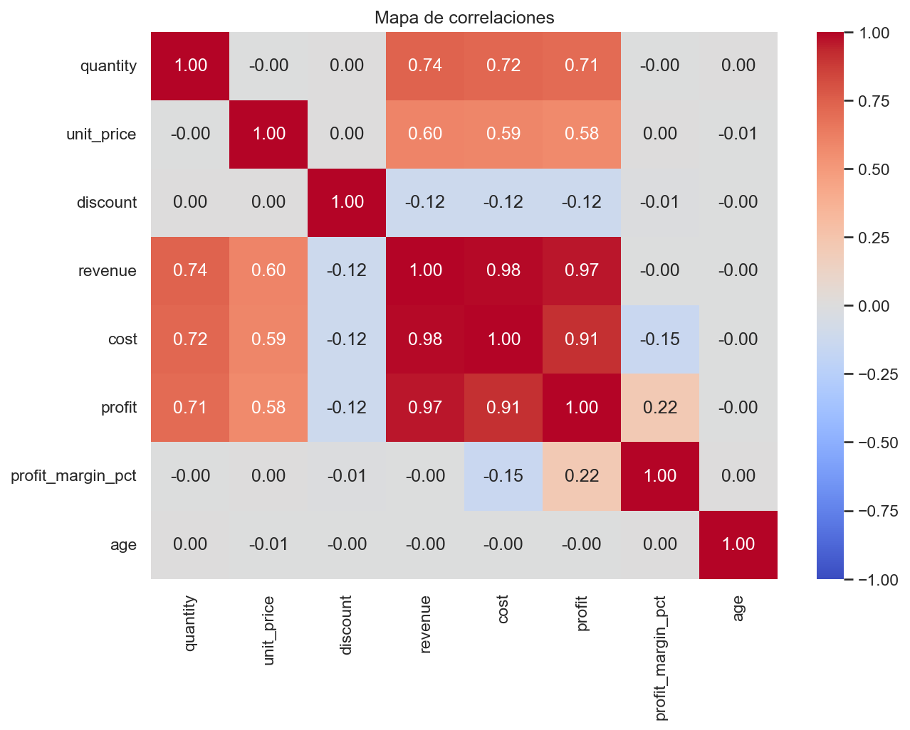

---

## 📈 12. Visualización

### Evolución de los ingresos diarios

Los ingresos diarios se mantienen estables durante los dos meses, entre 32.358,62 (30 de diciembre) y 36.173,38 (3 de diciembre). Los cinco mejores días son de diciembre, pero el mejor solo supera a la media diaria (34.747) en un 4,1 %. Fechas comerciales clave como el **Black Friday (24 de noviembre)** y el **viernes previo a Navidad (22 de diciembre)** figuran entre los días con menos ingresos.

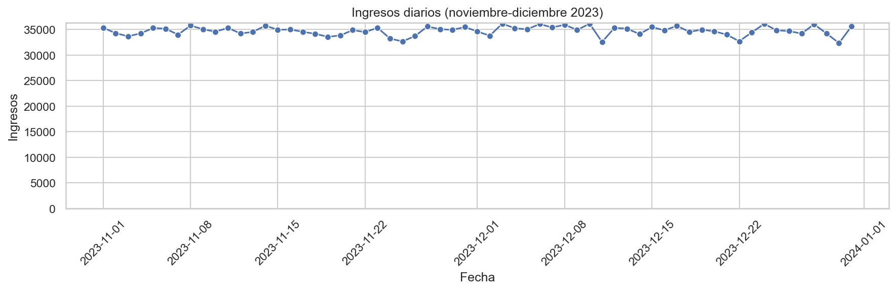

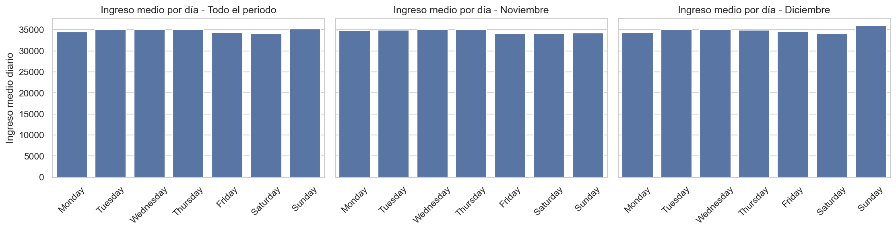

### Tiendas y ubicación

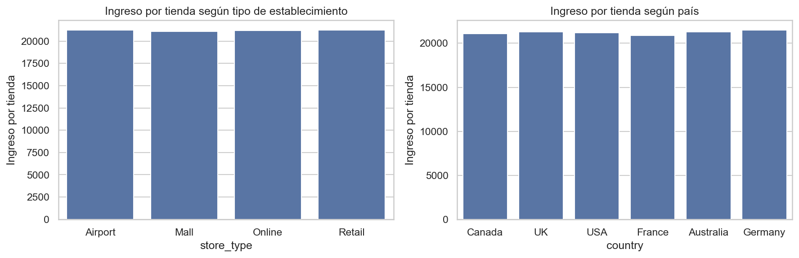

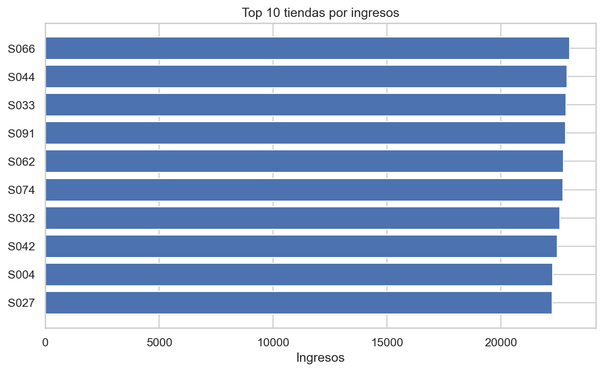

### Clientes y descuentos

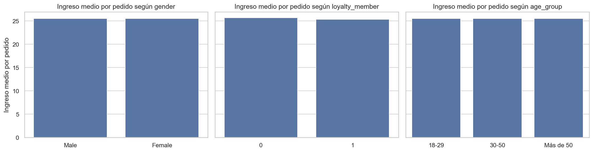

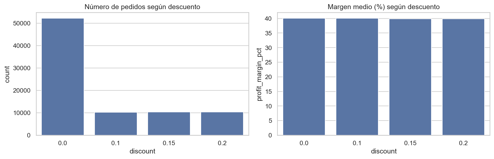

### Productos y concentración

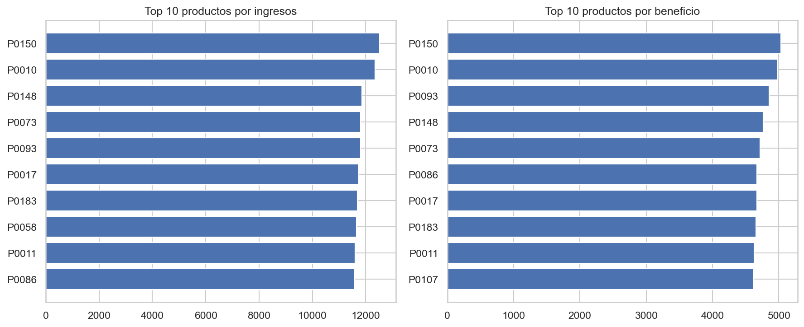

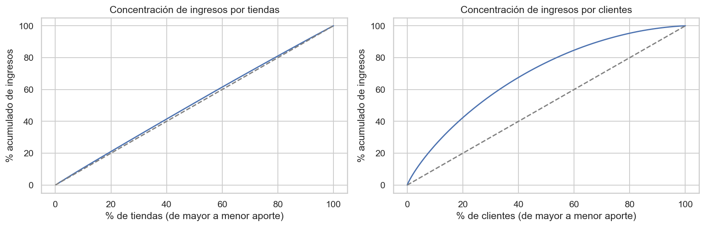

---

## 🖥 13. Dashboard

El dashboard se construyó en **Google Sheets** a partir del dataset final y se puede consultar en este enlace: [Dashboard – Ventas y rentabilidad](https://docs.google.com/spreadsheets/d/1q2x0RN6LHHyURW6ZTMsQDFFdJR2nHFJvDKQ740ye0SQ/edit?usp=sharing). En la carpeta `dashboard/` se incluye además una copia exportada en Excel y una captura.

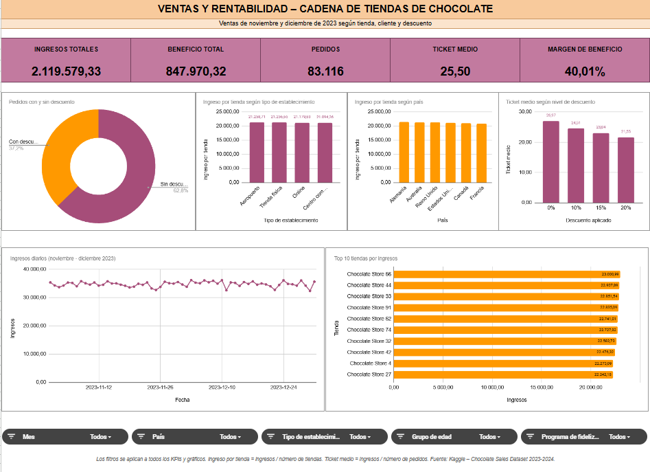

**Organización del archivo**

| Hoja | Contenido |
|---|---|
| `sales_nov-dec_2023_RAW`, `customer_RAW`, `store_RAW` | Datos originales sin modificar |
| `eda_limpio` | Dataset final (83.116 filas y 25 columnas), con 6 columnas auxiliares resaltadas que traducen los valores al español para los filtros y los gráficos |
| `Análisis` | 11 secciones numeradas, cada una con su tabla, su gráfico y una conclusión |
| `Dashboard` | Panel interactivo con los indicadores principales |
| `Informe` | Resumen del análisis, conclusiones y limitaciones |

**Contenido del dashboard**

- **5 indicadores clave:** ingresos totales, beneficio total, pedidos, ticket medio y margen de beneficio.
- **6 gráficos:** pedidos con y sin descuento, ingreso por tienda según tipo de establecimiento, ingreso por tienda según país, ticket medio según nivel de descuento, ingresos diarios y top 10 tiendas por ingresos.
- **5 filtros:** mes, país, tipo de establecimiento, grupo de edad y programa de fidelización. Se aplican a la vez a todos los indicadores y gráficos.

**Decisiones de diseño**

- Los gráficos usan **medidas comparables** (ingreso por tienda, ticket medio) en lugar de totales, ya que los totales dependen del número de tiendas o de días de cada grupo, como se demostró en el análisis.
- Todos los títulos, ejes y valores están **en español**, y las barras se ordenan de mayor a menor.
- Los gráficos de barras empiezan en cero para no exagerar diferencias pequeñas.
- Las tablas de detalle (ranking de tiendas con país y tipo, regularidad por país y comportamiento por cliente según la fidelización) se incluyen en la hoja `Análisis` para no sobrecargar el panel.

---

## 💡 14. Conclusiones

**El negocio presenta un comportamiento muy estable.** Las diferencias observadas en los ingresos totales se explican por factores de volumen (número de días, de tiendas o de clientes de cada grupo) y no por un mejor rendimiento por pedido. Este resultado se obtuvo al normalizar los indicadores y se confirmó con los contrastes estadísticos.

| Pregunta | Respuesta |
|---|---|
| ¿Aumentaron las ventas en diciembre? | En totales sí (+3,96 %), pero por día solo un 0,61 %, sin diferencia significativa. El aumento se debe a que diciembre tiene un día más. |
| ¿El mes con más ingresos fue el más rentable? | Diciembre tuvo más beneficio total (+3,85 %), pero el mismo margen (40,03 % frente a 39,99 %). |
| ¿Qué tiendas y tipos generaron más? | Airport genera más en total por tener más tiendas, pero el ingreso por tienda es casi igual en los cuatro tipos. La mejor tienda (S066) supera a la peor en un 23,4 %. |
| ¿Hay diferencias entre países? | Canadá lidera en totales por número de tiendas, pero por tienda es de los últimos. Alemania tiene el mayor ingreso por tienda y las tiendas más regulares, aunque las diferencias entre países (3,0 %) no son significativas. |
| ¿Qué clientes gastan más? | Ninguna característica se asocia a un mayor gasto. Los miembros del programa de fidelización compran con la misma frecuencia y gastan lo mismo por cliente que los no miembros. |
| ¿Influyen los descuentos? | El ingreso por pedido baja en proporción al descuento, pero el margen y las unidades por pedido no cambian. |
| ¿Qué productos aportan más? | P0150 y P0010 lideran en ingresos y beneficio; 9 de los 10 mejores coinciden en ambos rankings. Las ventas están muy repartidas. |
| ¿Hay días o fechas con más ventas? | No hay patrón semanal. Los mejores días son de diciembre, y el Black Friday está entre los peores. |
| ¿Hay concentración de ingresos? | En tiendas no (el 20 % aporta el 21,1 %). En clientes es moderada (el 20 % aporta el 42,3 %). |

## 💼 15. Implicaciones para el negocio

- **Evaluar el rendimiento con valores medios por día o por tienda:** comparar solo totales puede atribuir a un mes o a un país un mejor rendimiento que en realidad se debe al número de días o de tiendas.
- **Revisar la política de descuentos:** en el periodo analizado, los descuentos reducen el ingreso por pedido sin aumentar las unidades compradas.
- **Evaluar el coste del programa de fidelización:** sus miembros no compran más a menudo ni gastan más que los no miembros, y tampoco reciben claramente más descuentos. Se recomienda evaluar con los departamentos de marketing y finanzas si su coste se justifica por otros beneficios que este análisis no mide, como la permanencia de los clientes a largo plazo.
- **El crecimiento depende del número de tiendas:** como todas rinden de forma similar, los ingresos totales están más ligados a la cantidad de establecimientos que al tipo o la ubicación.
- **Estudiar el caso de Alemania:** es el país con las tiendas más regulares y el mayor ingreso por tienda. Con más datos (un periodo más largo y costes por tienda) podría valorarse si conviene ampliar la presencia en ese mercado; con los datos actuales la diferencia no es concluyente.

## ⚠️ 16. Limitaciones

- **Origen de los datos:** las tres tablas proceden del mismo dataset de Kaggle, aunque se integraron como tablas independientes.
- **Periodo analizado:** solo se dispone de dos meses, lo que impide estudiar tendencias o estacionalidad a lo largo del año.
- **Fecha de alta de los clientes:** no es fiable, por lo que no se utilizó y no puede asegurarse que los miembros del programa de fidelización lo fueran en el momento de la compra.
- **Ciudades y países:** se asumió que el país era el dato correcto y se reasignó la ciudad. Las tiendas Online tienen un país asignado cuyo significado geográfico no es claro.
- **Homogeneidad de los datos:** los márgenes son prácticamente constantes en todos los segmentos, varias variables siguen distribuciones uniformes y no hay aumentos de ventas en fechas comerciales como el Black Friday o la Navidad. Este comportamiento es compatible con un conjunto de datos de carácter didáctico o simulado, lo que limita la identificación de diferencias entre segmentos.

## 🔄 17. Próximos pasos

- Ampliar el análisis a un año completo para estudiar la estacionalidad.
- Incorporar una fuente de datos externa (por ejemplo, datos económicos o demográficos por país) para enriquecer el análisis geográfico.
- Analizar el comportamiento de compra a nivel de cliente (frecuencia, recurrencia y valor acumulado).

## 🤝 18. Contribuciones

Las sugerencias y contribuciones son bienvenidas. Si quieres proponer una mejora, puedes abrir una *issue* o un *pull request* en este repositorio.

## ✒️ 19. Autora y agradecimientos

- Sofía Consoli – [@SofiaConsoli](https://github.com/SofiaConsoli)

Proyecto realizado como trabajo final del programa **Data & Analytics de ThePower Education**. Gracias al equipo docente por el acompañamiento durante el programa.
